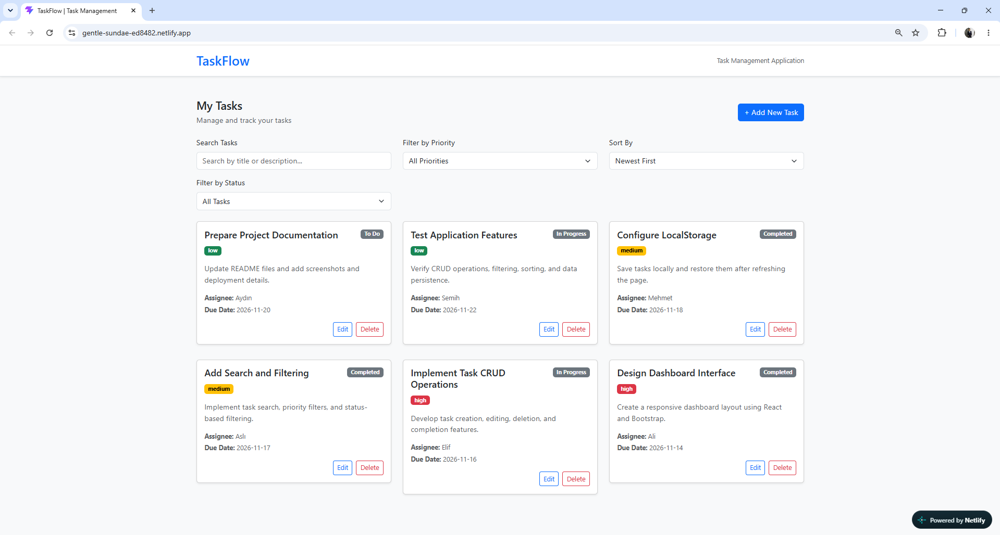

# TaskFlow

TaskFlow is a web-based task management project designed to help users organize tasks, manage priorities, assign responsibilities, and track progress.

The project consists of a React-based frontend application and a separate REST API developed with Node.js and Express.js.

The frontend currently uses browser LocalStorage for data persistence and operates independently of the backend API.

## Live Demo

The TaskFlow frontend is deployed on Netlify and is publicly accessible.

**Live Application:** https://gentle-sundae-ed8482.netlify.app

The live application supports task management (CRUD), searching, filtering, sorting, and LocalStorage persistence.

The deployed frontend does not require the backend REST API.

## Technologies

**Frontend**

- React.js
- Vite
- JavaScript (JSX)
- Bootstrap 5
- HTML5 and CSS3
- Browser LocalStorage

**Backend**

- Node.js
- Express.js
- JavaScript (ES Modules)
- JSON file storage

**Testing and Development**

- Postman
- ESLint

## Project Structure

```text
TaskFlow/
├── backend/
├── docs/
├── frontend/
└── README.md
```

The `backend/` and `frontend/` directories contain the respective applications, while `docs/` contains project documentation and screenshots.

Each application has its own README file with more detailed information.

## Features

### Frontend

- Create, view, update, and delete tasks (CRUD).
- Assign tasks to users.
- Manage task priorities (Low, Medium, High).
- Track task statuses (To Do, In Progress, Completed).
- Search tasks by title or description.
- Filter tasks by status and priority.
- Sort tasks by creation date, due date, or priority.
- Store task data in browser LocalStorage.
- Display feedback messages for task operations.
- Responsive interface using Bootstrap 5.

### Backend REST API

- Create, retrieve, update, and delete tasks.
- Assign tasks to users.
- Manage task priorities and statuses.
- Validate incoming API requests.
- Store task data in a local JSON file.
- Log incoming HTTP requests.
- Test REST API endpoints using Postman.

## Getting Started

### Frontend

To run the React application locally:

```bash
cd frontend
npm install
npm run dev
```

The application will typically be available at:

`http://localhost:5173`

To check the code and create a production build:

```bash
npm run lint
npm run build
```

### Backend

To run the REST API locally:

```bash
cd backend
npm install
npm run dev
```

The backend server will be available at:

`http://localhost:3000`

**Note:** The frontend and backend are currently independent. Running the frontend does not require starting the backend server.

## Documentation

- [Frontend README](frontend/README.md) – Frontend features, project structure, installation, and usage.
- [Backend README](backend/README.md) – API installation, endpoints, task data models, and validation rules.
- [Frontend Screenshots](docs/frontend-screenshots/) – Dashboard, CRUD operations, search, filtering, sorting, and Netlify deployment.

The `docs/` directory contains project documentation and Postman API test screenshots.

### Live Deployment Screenshot

The following screenshot shows the TaskFlow frontend running on Netlify with sample tasks.



## Project Status

**Frontend:** Implemented, tested, and deployed on Netlify. Task CRUD operations, search, filtering, sorting, and LocalStorage persistence have been successfully verified in the live environment.

**Backend:** REST API implemented and tested using Postman.

**Integration:** The frontend and backend have not yet been integrated. Backend integration and advanced workload analysis are potential future development stages.