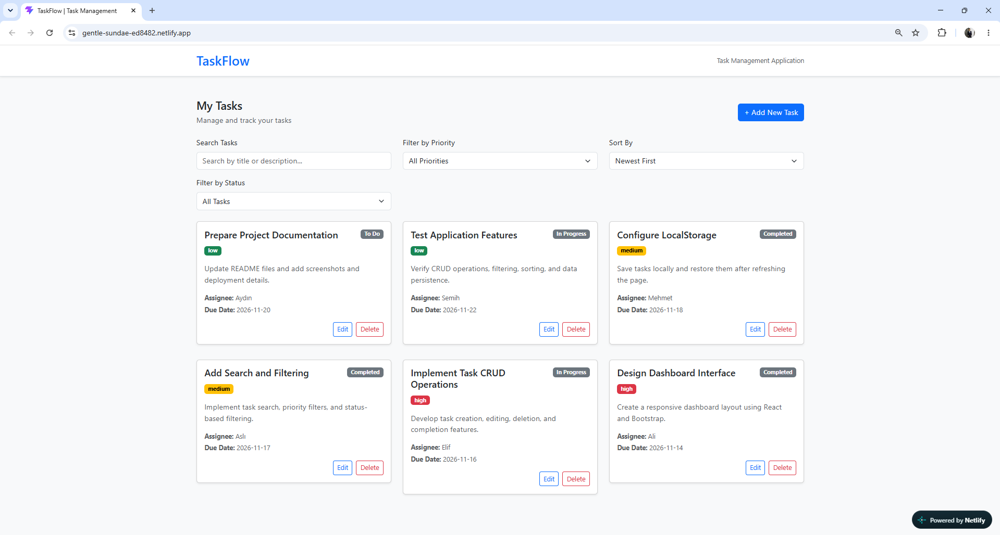

# TaskFlow – Frontend

TaskFlow is a web-based task management application built with React and Vite. It allows users to create, view, update, delete, search, filter, and sort tasks through a responsive interface.

This frontend currently operates independently using the browser's LocalStorage for data persistence.

## Live Demo

The TaskFlow frontend is deployed on Netlify and is publicly accessible.

**Live Application:** https://gentle-sundae-ed8482.netlify.app

The deployed application supports task creation, editing, deletion, searching, filtering, and sorting. Task data is stored in the browser's LocalStorage and persists after page refreshes.

The frontend operates independently and does not require the backend REST API.

## Technologies

- React.js
- Vite
- JavaScript (JSX)
- Bootstrap 5
- HTML5 and CSS3
- Browser LocalStorage

## Features

### Task Management (CRUD)

- **Create:** Add tasks with a title, description, priority, status, assignee, and optional due date.
- **Read:** Display saved tasks in a responsive card layout.
- **Update:** Edit existing task details and status.
- **Delete:** Remove tasks after user confirmation.

### Search and Filtering

- Search tasks by title or description.
- Filter tasks by status: To Do, In Progress, or Completed.
- Filter tasks by priority: Low, Medium, or High.
- Combine search and filters to find specific tasks.

### Sorting

- Newest First
- Oldest First
- Due Date (Earliest)
- Priority (High to Low)

### Data Persistence

Tasks are stored in the browser's LocalStorage. Changes are preserved when the page is refreshed in the same browser environment.

The application also provides feedback messages for successful operations and storage errors.

## Project Structure

```text
TaskFlow/
├── frontend/
│   ├── public/
│   │   └── favicon.svg
│   ├── src/
│   │   ├── components/
│   │   │   ├── Header.jsx
│   │   │   ├── TaskForm.jsx
│   │   │   ├── TaskItem.jsx
│   │   │   └── TaskList.jsx
│   │   ├── pages/
│   │   │   └── Dashboard.jsx
│   │   ├── services/
│   │   │   └── taskStorage.js
│   │   ├── App.jsx
│   │   ├── index.css
│   │   └── main.jsx
│   ├── .gitignore
│   ├── eslint.config.js
│   ├── index.html
│   ├── package-lock.json
│   ├── package.json
│   ├── README.md
│   └── vite.config.js
└── docs/
    └── frontend-screenshots/
        ├── 01-dashboard.png
        ├── 02-create-success.png
        ├── 02-create-task.png
        ├── 03-update-success.png
        ├── 03-update-task.png
        ├── 04-delete-success.png
        ├── 04-delete-task.png
        ├── 05-search.png
        ├── 06-filters.png
        ├── 07-sorting.png
        └── 08-netlify-deployment.png
```

### Screenshots

Screenshots demonstrating the TaskFlow frontend features are available in the [Frontend Screenshots](../docs/frontend-screenshots/) directory.

The screenshots cover the dashboard, task creation, task updates, task deletion, search, filtering, sorting, and live deployment.

The application has also been tested successfully in its deployed Netlify environment.

**Live Deployment Screenshot:**



## Installation and Setup

**Prerequisites:** Node.js and npm.

1. Navigate to the frontend directory:

   ```bash
   cd frontend
   ```

2. Install dependencies:

   ```bash
   npm install
   ```

3. Start the development server:

   ```bash
   npm run dev
   ```

4. Open the local URL displayed in the terminal (typically `http://localhost:5173`).

## Build and Code Quality

Run ESLint:

```bash
npm run lint
```

Create a production build:

```bash
npm run build
```

The production files will be generated in the `dist` directory.

## Current Scope

The frontend uses LocalStorage and does not currently require a backend server.

A separate Node.js and Express.js backend exists in the main TaskFlow repository. Backend integration and advanced workload analysis are outside the scope of this frontend version.

## Repository

[TaskFlow GitHub Repository](https://github.com/aydin-turan-ozbay/TaskFlow)